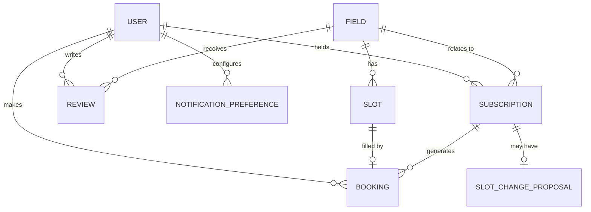
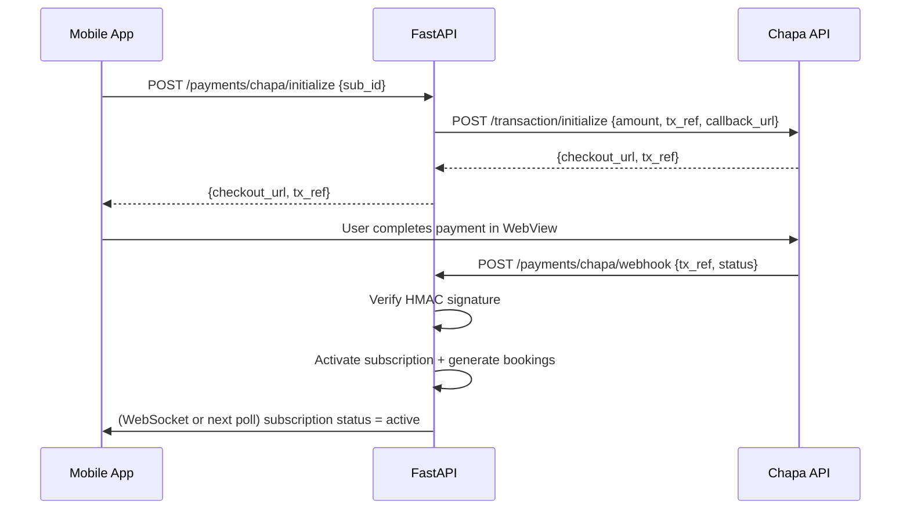

# MedaZone — Technical Design Document

## Overview

MedaZone is a mobile-first platform for players in Addis Ababa, Ethiopia, to discover nearby football fields, check real-time slot availability, and book playing time via subscription contracts with field owners. The platform is a full refactor of the FuelLink codebase, reusing its proven spatial search, real-time availability, booking slot management, push notifications, and admin dashboard patterns — adapted for sports-field bookings instead of fuel queues.

### System Boundaries

Three independently deployable components run behind Nginx and are orchestrated via Docker Compose:

```
Flutter Mobile App ─────┐
                         ├──► Nginx ──► FastAPI (Uvicorn, port 8000)
React Admin Dashboard ──┘                ├──► PostgreSQL 16 + PostGIS 3.4
                                         ├──► Redis 7 (cache + pub/sub)
                                         └──► Firebase Admin SDK v6 (FCM)
```

### Key Design Decisions

- **Subscription-gated bookings**: Players may only book through a subscription contract proposed by a Field Owner and paid upfront. One-off booking without a subscription is rejected (HTTP 403 `SUBSCRIPTION_REQUIRED`).
- **Soft reservation**: A 5-minute in-memory soft reservation (Redis key) prevents double-booking while a player is on the payment screen.
- **WebSocket fanout via Redis pub/sub**: All slot status changes are published to a Redis channel keyed by `field:{field_id}:slots`. Every connected WebSocket client subscribed to that field receives the update within 500 ms.
- **OpenStreetMap only**: flutter_map 6 with OpenStreetMap tiles — no Google Maps billing.
- **PostGIS spatial queries**: Field discovery uses `ST_DWithin` on a `GEOGRAPHY` column for accurate distance calculations in metres.
- **APScheduler for maintenance jobs**: Three recurring jobs handle soft-reservation expiry, booking reminders, and sponsorship expiry.

---

## Architecture

### High-Level Component Diagram

```mermaid
graph TD
    subgraph Mobile [Flutter Mobile App]
        MA_Map[Map / Discovery]
        MA_Field[Field Detail]
        MA_Sub[Subscription Screen]
        MA_Pay[Payment Screen]
        MA_Book[Bookings List]
        MA_Auth[Auth]
    end

    subgraph AdminWeb [React Admin Dashboard]
        AW_Login[Login — Firebase OTP]
        AW_Fields[Field Management]
        AW_Slots[Slot Management]
        AW_Books[Bookings & Check-in]
        AW_Analytics[Analytics]
        AW_Users[User Management]
    end

    subgraph Backend [FastAPI Backend]
        direction TB
        R_Auth[/api/v1/auth]
        R_Fields[/api/v1/fields]
        R_Slots[/api/v1/slots]
        R_Bookings[/api/v1/bookings]
        R_Subs[/api/v1/subscriptions]
        R_Reviews[/api/v1/reviews]
        R_Admin[/api/v1/admin]
        R_Payments[/api/v1/payments]
        WS[/ws/fields/{field_id}]
        Sched[APScheduler]
        NotifSvc[Notification Service]
    end

    subgraph Infra [Infrastructure]
        PG[(PostgreSQL + PostGIS)]
        Redis[(Redis 7)]
        FCM[Firebase FCM]
        Chapa[Chapa API]
        ArifPay[ArifPay API]
    end

    Mobile -->|HTTPS REST + WSS| Backend
    AdminWeb -->|HTTPS REST| Backend
    Backend --> PG
    Backend --> Redis
    NotifSvc --> FCM
    R_Payments --> Chapa
    R_Payments --> ArifPay
    WS -->|pub/sub fanout| Redis
```

### Request Lifecycle

1. Mobile/Admin sends HTTPS request through Nginx to FastAPI.
2. JWT middleware validates `Authorization: Bearer <token>` on protected routes.
3. Router delegates to the appropriate service function.
4. Service performs async DB query (SQLAlchemy 2.0 async session) and/or Redis operation.
5. On slot state changes, service publishes a message to Redis channel `field:{id}:slots`.
6. WebSocket handler subscribes to that channel; connected clients receive the update.
7. Notification service calls Firebase FCM v1 API asynchronously via Firebase Admin SDK.

---

## Components and Interfaces

### Backend — Router Map

| Router module | Prefix | Responsibilities |
|---|---|---|
| `auth.py` | `/api/v1/auth` | Register, OTP verify, login, refresh, logout, OTP lock |
| `fields.py` | `/api/v1/fields` | Spatial search, field CRUD, filter/search, sponsorship |
| `slots.py` | `/api/v1/slots` | Slot generation, status change, soft reservation |
| `bookings.py` | `/api/v1/bookings` | View, cancel, QR check-in |
| `subscriptions.py` | `/api/v1/subscriptions` | Propose, view, payment webhook, history, slot-change workflow |
| `reviews.py` | `/api/v1/reviews` | Submit, list per field |
| `notifications.py` | `/api/v1/notifications` | Preference CRUD per player |
| `payments.py` | `/api/v1/payments` | Chapa + ArifPay init, webhook verification |
| `admin.py` | `/api/v1/admin` | User management, analytics, super-admin ops |
| `websockets.py` | `/ws/fields/{field_id}` | WebSocket upgrade, subscribe/receive slot updates |

### Backend — Service Layer

| Service | Key responsibilities |
|---|---|
| `auth_service.py` | OTP generation/validation, JWT issue/refresh, OTP lock (Redis TTL) |
| `field_service.py` | PostGIS `ST_DWithin` queries, field CRUD, filter composition, sponsorship |
| `slot_service.py` | Slot generation (recurring), soft reservation (Redis), status transitions |
| `booking_service.py` | Auto-generate bookings from subscription, cancel with refund policy, check-in |
| `subscription_service.py` | Price calculation, contract lifecycle, slot-change proposal, renewal |
| `review_service.py` | Eligibility check (checked_in booking required), persist, recalculate avg rating |
| `notification_service.py` | FCM message construction + dispatch, preference filtering |
| `payment_service.py` | Chapa/ArifPay payment init, signature verification, callback handling |
| `analytics_service.py` | Platform-wide and per-field aggregates for admin dashboard |

### Mobile App — Feature Modules

| Feature folder | Screens | Providers |
|---|---|---|
| `auth/` | LoginScreen, OtpScreen, RegisterScreen | `authProvider` (AuthNotifier) |
| `map/` | MapScreen | `nearbyFieldsProvider`, `locationProvider` |
| `field/` | FieldDetailScreen, FieldSummaryCard | `fieldDetailProvider`, `slotCalendarProvider` |
| `booking/` | BookingConfirmScreen, BookingsListScreen, BookingDetailScreen | `bookingProvider`, `bookingsListProvider` |
| `subscription/` | SubscriptionDetailScreen, SubscriptionManagementScreen | `pendingSubscriptionProvider`, `activeSubscriptionProvider` |
| `payment/` | PaymentScreen | `paymentProvider` |
| `notifications/` | NotificationSettingsScreen | `notifPrefsProvider` |
| `profile/` | ProfileScreen | `profileProvider` |
| `splash/` | SplashScreen | reads `authProvider` |

### Admin Web — Pages

| Page | Route | Role |
|---|---|---|
| `LoginPage.tsx` | `/login` | All |
| `OverviewPage.tsx` | `/` | SUPER_ADMIN |
| `FieldsPage.tsx` | `/fields` | FIELD_OWNER, SUPER_ADMIN |
| `FieldCreatePage.tsx` | `/fields/new` | FIELD_OWNER, SUPER_ADMIN |
| `SlotsPage.tsx` | `/fields/:id/slots` | FIELD_OWNER, SUPER_ADMIN |
| `BookingsPage.tsx` | `/fields/:id/bookings` | FIELD_OWNER, SUPER_ADMIN |
| `CheckInPage.tsx` | `/fields/:id/checkin` | FIELD_OWNER, SUPER_ADMIN |
| `SubscriptionsPage.tsx` | `/fields/:id/subscriptions` | FIELD_OWNER, SUPER_ADMIN |
| `AnalyticsPage.tsx` | `/analytics` | SUPER_ADMIN |
| `UserManagementPage.tsx` | `/users` | SUPER_ADMIN |

---

## Data Models

### Entity Relationship Overview



### SQLAlchemy ORM Models

#### `User` (`users` table)

```python
class User(Base):
    __tablename__ = "users"

    id: Mapped[uuid.UUID] = mapped_column(primary_key=True, default=uuid.uuid4)
    phone_number: Mapped[str] = mapped_column(String(20), unique=True, nullable=False)
    display_name: Mapped[str | None] = mapped_column(String(100))
    profile_photo_url: Mapped[str | None] = mapped_column(Text)
    preferred_positions: Mapped[list[str]] = mapped_column(ARRAY(String), default=[])
    role: Mapped[str] = mapped_column(String(20), default="PLAYER")
    # roles: PLAYER | FIELD_OWNER | SUPER_ADMIN
    fcm_token: Mapped[str | None] = mapped_column(Text)
    refresh_token_hash: Mapped[str | None] = mapped_column(Text)
    is_active: Mapped[bool] = mapped_column(default=True)
    created_at: Mapped[datetime] = mapped_column(server_default=func.now())
    updated_at: Mapped[datetime] = mapped_column(onupdate=func.now(), server_default=func.now())
```

#### `Field` (`fields` table)

```python
class Field(Base):
    __tablename__ = "fields"

    id: Mapped[uuid.UUID] = mapped_column(primary_key=True, default=uuid.uuid4)
    owner_id: Mapped[uuid.UUID] = mapped_column(ForeignKey("users.id"), nullable=False)
    name: Mapped[str] = mapped_column(String(200), nullable=False)
    address: Mapped[str] = mapped_column(Text, nullable=False)
    neighborhood: Mapped[str | None] = mapped_column(String(100))
    location: Mapped[WKBElement] = mapped_column(
        Geometry("POINT", srid=4326, spatial_index=True), nullable=False
    )
    surface_type: Mapped[str] = mapped_column(String(20), nullable=False)
    # grass | artificial | futsal
    field_size: Mapped[str | None] = mapped_column(String(20))
    # 5-a-side | 7-a-side | 11-a-side
    amenities: Mapped[dict] = mapped_column(JSONB, default={})
    # {"lighting": true, "changing_rooms": false, "parking": true, "water": true}
    price_per_hour: Mapped[Decimal] = mapped_column(Numeric(10, 2), nullable=False)
    operating_hours: Mapped[dict] = mapped_column(JSONB, default={})
    # {"open": "06:00", "close": "22:00", "days": ["Mon","Tue","Wed","Thu","Fri","Sat","Sun"]}
    photo_urls: Mapped[list[str]] = mapped_column(ARRAY(Text), default=[])
    average_rating: Mapped[Decimal] = mapped_column(Numeric(3, 2), default=0.0)
    review_count: Mapped[int] = mapped_column(default=0)
    is_active: Mapped[bool] = mapped_column(default=True)
    is_sponsored: Mapped[bool] = mapped_column(default=False)
    sponsorship_start: Mapped[date | None] = mapped_column(Date)
    sponsorship_end: Mapped[date | None] = mapped_column(Date)
    created_at: Mapped[datetime] = mapped_column(server_default=func.now())
    updated_at: Mapped[datetime] = mapped_column(onupdate=func.now(), server_default=func.now())
```

#### `Slot` (`slots` table)

```python
class Slot(Base):
    __tablename__ = "slots"
    __table_args__ = (
        UniqueConstraint("field_id", "slot_date", "start_time", name="uq_slot_field_date_time"),
    )

    id: Mapped[uuid.UUID] = mapped_column(primary_key=True, default=uuid.uuid4)
    field_id: Mapped[uuid.UUID] = mapped_column(ForeignKey("fields.id"), nullable=False)
    slot_date: Mapped[date] = mapped_column(Date, nullable=False)
    start_time: Mapped[time] = mapped_column(Time, nullable=False)
    end_time: Mapped[time] = mapped_column(Time, nullable=False)
    duration_minutes: Mapped[int] = mapped_column(nullable=False)
    # 30 | 60 | 90
    status: Mapped[str] = mapped_column(String(20), default="available")
    # available | pending | booked | closed
    soft_reserved_until: Mapped[datetime | None] = mapped_column(DateTime(timezone=True))
    soft_reserved_by: Mapped[uuid.UUID | None] = mapped_column(ForeignKey("users.id"))
    created_at: Mapped[datetime] = mapped_column(server_default=func.now())
```

#### `Booking` (`bookings` table)

```python
class Booking(Base):
    __tablename__ = "bookings"
    __table_args__ = (
        UniqueConstraint("field_id", "slot_date", "slot_start_time", name="uq_booking_field_slot"),
    )

    id: Mapped[uuid.UUID] = mapped_column(primary_key=True, default=uuid.uuid4)
    reference: Mapped[str] = mapped_column(String(20), unique=True, nullable=False)
    # e.g. "MZ-20250612-AB4F"
    player_id: Mapped[uuid.UUID] = mapped_column(ForeignKey("users.id"), nullable=False)
    field_id: Mapped[uuid.UUID] = mapped_column(ForeignKey("fields.id"), nullable=False)
    slot_id: Mapped[uuid.UUID] = mapped_column(ForeignKey("slots.id"), nullable=False)
    subscription_id: Mapped[uuid.UUID | None] = mapped_column(ForeignKey("subscriptions.id"))
    slot_date: Mapped[date] = mapped_column(Date, nullable=False)
    slot_start_time: Mapped[time] = mapped_column(Time, nullable=False)
    slot_end_time: Mapped[time] = mapped_column(Time, nullable=False)
    status: Mapped[str] = mapped_column(String(20), default="confirmed")
    # confirmed | checked_in | cancelled
    cancellation_reason: Mapped[str | None] = mapped_column(String(50))
    # player_initiated | field_owner_initiated
    cancelled_at: Mapped[datetime | None] = mapped_column(DateTime(timezone=True))
    checked_in_at: Mapped[datetime | None] = mapped_column(DateTime(timezone=True))
    created_at: Mapped[datetime] = mapped_column(server_default=func.now())
```

#### `Subscription` (`subscriptions` table)

```python
class Subscription(Base):
    __tablename__ = "subscriptions"

    id: Mapped[uuid.UUID] = mapped_column(primary_key=True, default=uuid.uuid4)
    player_id: Mapped[uuid.UUID] = mapped_column(ForeignKey("users.id"), nullable=False)
    field_id: Mapped[uuid.UUID] = mapped_column(ForeignKey("fields.id"), nullable=False)
    proposed_by: Mapped[uuid.UUID] = mapped_column(ForeignKey("users.id"), nullable=False)
    # field owner's user id
    recurring_days: Mapped[list[str]] = mapped_column(ARRAY(String), nullable=False)
    # e.g. ["Monday", "Wednesday"]
    session_start_time: Mapped[time] = mapped_column(Time, nullable=False)
    session_duration_hours: Mapped[Decimal] = mapped_column(Numeric(4, 2), nullable=False)
    tier: Mapped[str] = mapped_column(String(20), nullable=False)
    # 1_month | 2_months | 3_months
    total_sessions: Mapped[int] = mapped_column(nullable=False)
    total_price: Mapped[Decimal] = mapped_column(Numeric(12, 2), nullable=False)
    status: Mapped[str] = mapped_column(String(30), default="pending_payment")
    # pending_payment | active | expired | cancelled
    start_date: Mapped[date | None] = mapped_column(Date)
    expiry_date: Mapped[date | None] = mapped_column(Date)
    payment_provider: Mapped[str | None] = mapped_column(String(20))
    # chapa | arifpay
    payment_tx_ref: Mapped[str | None] = mapped_column(String(100))
    created_at: Mapped[datetime] = mapped_column(server_default=func.now())
    updated_at: Mapped[datetime] = mapped_column(onupdate=func.now(), server_default=func.now())
```

#### `SlotChangeProposal` (`slot_change_proposals` table)

```python
class SlotChangeProposal(Base):
    __tablename__ = "slot_change_proposals"

    id: Mapped[uuid.UUID] = mapped_column(primary_key=True, default=uuid.uuid4)
    subscription_id: Mapped[uuid.UUID] = mapped_column(ForeignKey("subscriptions.id"), nullable=False)
    proposed_by: Mapped[uuid.UUID] = mapped_column(ForeignKey("users.id"), nullable=False)
    new_recurring_days: Mapped[list[str]] = mapped_column(ARRAY(String), nullable=False)
    new_session_start_time: Mapped[time] = mapped_column(Time, nullable=False)
    new_session_duration_hours: Mapped[Decimal] = mapped_column(Numeric(4, 2), nullable=False)
    status: Mapped[str] = mapped_column(String(20), default="pending")
    # pending | approved | rejected | expired
    expires_at: Mapped[datetime] = mapped_column(DateTime(timezone=True), nullable=False)
    created_at: Mapped[datetime] = mapped_column(server_default=func.now())
```

#### `Review` (`reviews` table)

```python
class Review(Base):
    __tablename__ = "reviews"
    __table_args__ = (
        UniqueConstraint("player_id", "booking_id", name="uq_review_player_booking"),
    )

    id: Mapped[uuid.UUID] = mapped_column(primary_key=True, default=uuid.uuid4)
    player_id: Mapped[uuid.UUID] = mapped_column(ForeignKey("users.id"), nullable=False)
    field_id: Mapped[uuid.UUID] = mapped_column(ForeignKey("fields.id"), nullable=False)
    booking_id: Mapped[uuid.UUID] = mapped_column(ForeignKey("bookings.id"), nullable=False)
    rating: Mapped[int] = mapped_column(Integer, nullable=False)
    # 1–5
    review_text: Mapped[str | None] = mapped_column(Text)
    created_at: Mapped[datetime] = mapped_column(server_default=func.now())
```

#### `NotificationPreference` (`notification_preferences` table)

```python
class NotificationPreference(Base):
    __tablename__ = "notification_preferences"
    __table_args__ = (
        UniqueConstraint("player_id", name="uq_notif_pref_player"),
    )

    id: Mapped[uuid.UUID] = mapped_column(primary_key=True, default=uuid.uuid4)
    player_id: Mapped[uuid.UUID] = mapped_column(ForeignKey("users.id"), nullable=False)
    booking_confirmed: Mapped[bool] = mapped_column(default=True)
    booking_reminder: Mapped[bool] = mapped_column(default=True)
    booking_cancelled: Mapped[bool] = mapped_column(default=True)
    slot_available: Mapped[bool] = mapped_column(default=True)
    subscription_expiry: Mapped[bool] = mapped_column(default=True)
    # fields the player has opted into availability alerts for
    watched_field_ids: Mapped[list[str]] = mapped_column(ARRAY(Text), default=[])
    created_at: Mapped[datetime] = mapped_column(server_default=func.now())
    updated_at: Mapped[datetime] = mapped_column(onupdate=func.now(), server_default=func.now())
```

### Redis Key Schema

| Key pattern | Type | TTL | Purpose |
|---|---|---|---|
| `otp:{phone}` | String (6-digit OTP) | 5 min | OTP verification |
| `otp_lock:{phone}` | String ("locked") | 10 min | OTP brute-force lock |
| `soft_res:{slot_id}` | String (player_id) | 5 min | Soft reservation |
| `field:{field_id}:slots` | Pub/sub channel | — | WebSocket fanout |
| `slot_avail:{field_id}` | Hash (slot_id → status) | 1 min | Availability cache |
| `session:{jti}` | String ("valid") | 30 days | Refresh token revocation |

---

## API Design

All REST routes are prefixed `/api/v1`. WebSocket routes are under `/ws/`. Auth uses `Authorization: Bearer <access_token>` unless noted.

### Authentication (`/api/v1/auth`)

| Method | Path | Auth | Description |
|---|---|---|---|
| POST | `/auth/request-otp` | None | Send OTP to phone number |
| POST | `/auth/verify-otp` | None | Verify OTP, return access + refresh tokens |
| POST | `/auth/refresh` | None (refresh token in body) | Issue new access token |
| POST | `/auth/logout` | Player | Revoke refresh token |
| POST | `/auth/admin/login` | None | Field Owner / Super Admin Firebase token exchange |

**Request: `POST /auth/request-otp`**
```json
{ "phone_number": "+251912345678" }
```

**Response: `POST /auth/verify-otp`**
```json
{
  "access_token": "<jwt>",
  "refresh_token": "<jwt>",
  "token_type": "bearer",
  "user": { "id": "...", "phone_number": "...", "display_name": "...", "role": "PLAYER" }
}
```

### Fields (`/api/v1/fields`)

| Method | Path | Auth | Description |
|---|---|---|---|
| GET | `/fields` | Optional | Spatial + filter search |
| GET | `/fields/{field_id}` | Optional | Field detail |
| POST | `/fields` | FIELD_OWNER, SUPER_ADMIN | Create field |
| PUT | `/fields/{field_id}` | FIELD_OWNER (own), SUPER_ADMIN | Update field |
| PATCH | `/fields/{field_id}/status` | FIELD_OWNER (own), SUPER_ADMIN | Set active/inactive |
| PATCH | `/fields/{field_id}/sponsor` | SUPER_ADMIN | Set sponsorship dates |

**Query params for `GET /fields`:**
- `lat`, `lng` — player GPS (required for spatial sort; falls back to Addis Ababa center)
- `radius_km` — default 10
- `surface_type` — grass | artificial | futsal
- `amenities` — comma-separated: lighting, changing_rooms, parking, water
- `min_price`, `max_price` — ETB per hour
- `available_date` — YYYY-MM-DD
- `q` — text search (name / neighborhood, case-insensitive ILIKE)

### Slots (`/api/v1/slots`)

| Method | Path | Auth | Description |
|---|---|---|---|
| GET | `/fields/{field_id}/slots` | Optional | Get slots for next 7 days |
| POST | `/fields/{field_id}/slots/generate` | FIELD_OWNER | Generate recurring slots |
| PATCH | `/slots/{slot_id}/status` | FIELD_OWNER | Close a slot manually |
| POST | `/slots/{slot_id}/reserve` | Player | Create 5-min soft reservation |
| DELETE | `/slots/{slot_id}/reserve` | Player | Release soft reservation |

**Request: `POST /fields/{field_id}/slots/generate`**
```json
{
  "start_date": "2025-07-01",
  "end_date": "2025-09-30",
  "slot_duration_minutes": 60,
  "open_time": "06:00",
  "close_time": "22:00"
}
```
**Response:** `{ "created_count": 184, "skipped_count": 12 }`

### Subscriptions (`/api/v1/subscriptions`)

| Method | Path | Auth | Description |
|---|---|---|---|
| POST | `/subscriptions` | FIELD_OWNER | Propose subscription contract |
| GET | `/subscriptions/{sub_id}` | Player, FIELD_OWNER | Get contract detail |
| GET | `/subscriptions/player/me` | Player | All subscriptions for current player |
| POST | `/subscriptions/{sub_id}/pay` | Player | Initiate payment (Chapa or ArifPay) |
| GET | `/subscriptions/{sub_id}/history` | Player | Full subscription history |
| POST | `/subscriptions/{sub_id}/request-renewal` | Player | Notify field owner to renew |
| POST | `/subscriptions/{sub_id}/slot-change` | FIELD_OWNER | Propose recurring slot change |
| PATCH | `/subscriptions/{sub_id}/slot-change/{proposal_id}` | Player | Approve / reject slot change |
| GET | `/subscriptions/stats` | SUPER_ADMIN | Active subscriptions per tier and field |

**Request: `POST /subscriptions`**
```json
{
  "player_id": "...",
  "field_id": "...",
  "recurring_days": ["Monday", "Wednesday"],
  "session_start_time": "16:00",
  "session_duration_hours": 2.0,
  "tier": "1_month"
}
```
**Response includes:** `total_sessions`, `total_price`, `status: "pending_payment"`

### Bookings (`/api/v1/bookings`)

| Method | Path | Auth | Description |
|---|---|---|---|
| GET | `/bookings/me` | Player | List player's bookings (upcoming + past) |
| GET | `/bookings/{booking_id}` | Player | Booking detail + QR reference |
| DELETE | `/bookings/{booking_id}` | Player | Cancel booking (≥2 hr window) |
| POST | `/bookings/{booking_id}/checkin` | FIELD_OWNER | Mark checked-in |
| GET | `/bookings/verify/{reference}` | FIELD_OWNER | Look up booking by reference |

### Reviews (`/api/v1/reviews`)

| Method | Path | Auth | Description |
|---|---|---|---|
| POST | `/reviews` | Player | Submit rating + review |
| GET | `/fields/{field_id}/reviews` | Optional | Paginated reviews for a field |

**Request: `POST /reviews`**
```json
{ "field_id": "...", "booking_id": "...", "rating": 4, "review_text": "Great pitch!" }
```

### Notifications (`/api/v1/notifications`)

| Method | Path | Auth | Description |
|---|---|---|---|
| GET | `/notifications/preferences` | Player | Get notification preferences |
| PUT | `/notifications/preferences` | Player | Update preferences |
| POST | `/notifications/watch/{field_id}` | Player | Watch a field for availability |
| DELETE | `/notifications/watch/{field_id}` | Player | Unwatch a field |
| PUT | `/users/me/fcm-token` | Player | Register / update FCM token |

### Payments (`/api/v1/payments`)

| Method | Path | Auth | Description |
|---|---|---|---|
| POST | `/payments/chapa/initialize` | Player | Initialize Chapa payment session |
| POST | `/payments/chapa/webhook` | None (HMAC sig) | Chapa server-to-server callback |
| POST | `/payments/arifpay/initialize` | Player | Initialize ArifPay payment session |
| POST | `/payments/arifpay/webhook` | None (sig) | ArifPay server-to-server callback |

### Admin (`/api/v1/admin`)

| Method | Path | Auth | Description |
|---|---|---|---|
| GET | `/admin/users` | SUPER_ADMIN | List all users with role filter |
| POST | `/admin/users` | SUPER_ADMIN | Create field owner account |
| PATCH | `/admin/users/{user_id}` | SUPER_ADMIN | Edit / deactivate user |
| GET | `/admin/analytics` | SUPER_ADMIN | Platform-wide analytics |
| GET | `/admin/analytics/subscriptions` | SUPER_ADMIN | Active subs per tier + field |

### WebSocket (`/ws`)

| Path | Description |
|---|---|
| `/ws/fields/{field_id}` | Slot availability updates for a specific field |

**Message format (server → client):**
```json
{
  "type": "slot_update",
  "slot_id": "...",
  "status": "booked",
  "slot_date": "2025-07-14",
  "start_time": "16:00",
  "end_time": "17:00"
}
```

---

## Real-Time Communication Design

### WebSocket + Redis Pub/Sub Architecture

```mermaid
sequenceDiagram
    participant App as Mobile App
    participant WS as WS Handler (FastAPI)
    participant Redis as Redis Pub/Sub
    participant SvcA as slot_service (any backend instance)

    App->>WS: Connect /ws/fields/{field_id}
    WS->>Redis: SUBSCRIBE field:{field_id}:slots
    Note over WS,Redis: Connection held; messages forwarded to App

    SvcA->>Redis: PUBLISH field:{field_id}:slots {"slot_id": ..., "status": "booked"}
    Redis-->>WS: Message delivery
    WS-->>App: {"type":"slot_update","slot_id":...,"status":"booked"}

    App->>WS: Disconnect
    WS->>Redis: UNSUBSCRIBE field:{field_id}:slots
```

### WebSocket Handler (`websockets/slots.py`)

```python
async def field_slot_ws(websocket: WebSocket, field_id: str, redis: Redis):
    await websocket.accept()
    channel = f"field:{field_id}:slots"
    pubsub = redis.pubsub()
    await pubsub.subscribe(channel)
    try:
        async for message in pubsub.listen():
            if message["type"] == "message":
                await websocket.send_text(message["data"])
    except WebSocketDisconnect:
        await pubsub.unsubscribe(channel)
    finally:
        await pubsub.close()
```

Every time `slot_service` changes a slot's status it publishes:

```python
await redis.publish(
    f"field:{slot.field_id}:slots",
    SlotUpdateMessage(
        type="slot_update",
        slot_id=str(slot.id),
        status=slot.status,
        slot_date=slot.slot_date.isoformat(),
        start_time=slot.start_time.strftime("%H:%M"),
        end_time=slot.end_time.strftime("%H:%M"),
    ).model_dump_json()
)
```

### Mobile WebSocket Client (`features/field/slot_ws_provider.dart`)

- Opens `web_socket_channel` to `WS_BASE_URL/ws/fields/{field_id}` when `FieldDetailScreen` is mounted.
- Reconnects with exponential backoff: 2 s → 4 s → 8 s … cap 30 s.
- On reconnect, performs a REST `GET /fields/{field_id}/slots` to reconcile any missed updates.
- Disposes the channel when the screen is unmounted.

### Soft Reservation Flow

```
Player lands on BookingConfirmScreen
  → POST /slots/{slot_id}/reserve
      → SET soft_res:{slot_id} {player_id} EX 300 (Redis)
      → UPDATE slots SET status='pending' WHERE id=slot_id
      → PUBLISH field:{field_id}:slots {slot_id, status:'pending'}

Player pays within 5 min
  → POST /subscriptions/{sub_id}/pay → webhook confirms payment
      → DELETE soft_res:{slot_id} (Redis)
      → slot status set to 'booked' via booking creation

Player abandons or timer fires
  → APScheduler job (every 2 min) finds expired soft_res keys
      → UPDATE slots SET status='available'
      → PUBLISH field:{field_id}:slots {slot_id, status:'available'}
```

---

## Background Jobs Design

All jobs are registered in `tasks/scheduler.py` using APScheduler's `AsyncIOScheduler` with `IntervalTrigger`.

### Job 1: Soft Reservation Expiry (every 2 minutes)

**Purpose:** Release slots whose soft reservation has expired without a confirmed payment.

```python
@scheduler.scheduled_job("interval", minutes=2, id="expire_soft_reservations")
async def expire_soft_reservations():
    """
    Find all slots with status='pending' and soft_reserved_until < now().
    Set status='available', clear soft_reserved_by/until.
    Publish WebSocket update for each affected field.
    """
```

**Steps:**
1. Query `slots` WHERE `status = 'pending' AND soft_reserved_until < NOW()`.
2. Bulk-update status to `available`.
3. For each affected slot, `PUBLISH field:{field_id}:slots {slot_id, status:'available'}`.
4. Log count of released slots.

### Job 2: Booking Reminder Notifications (every 1 minute)

**Purpose:** Send FCM reminder 60 minutes before a booked session starts.

```python
@scheduler.scheduled_job("interval", minutes=1, id="send_booking_reminders")
async def send_booking_reminders():
    """
    Find confirmed bookings where slot starts in 55-65 minutes (to avoid double-fire).
    Send FCM reminder if player has booking_reminder preference enabled.
    """
```

**Steps:**
1. Query `bookings` JOIN `slots` WHERE `status = 'confirmed'` AND slot datetime is in `[now+55min, now+65min]`.
2. Fetch player FCM token and `booking_reminder` preference.
3. Dispatch FCM via `notification_service.send_booking_reminder(booking)`.
4. Log dispatched count; log any FCM errors individually.

### Job 3: Sponsorship Expiry (every 60 minutes)

**Purpose:** Remove sponsored status from fields whose sponsorship end date has passed.

```python
@scheduler.scheduled_job("interval", minutes=60, id="expire_sponsorships")
async def expire_sponsorships():
    """
    Find fields with is_sponsored=True and sponsorship_end < today.
    Set is_sponsored=False, clear sponsorship dates.
    """
```

### Job 4: Subscription Expiry Notifications (every 60 minutes)

**Purpose:** Send FCM alerts 3 days before expiry and on expiry day; transition expired subscriptions.

```python
@scheduler.scheduled_job("interval", minutes=60, id="process_subscription_expiry")
async def process_subscription_expiry():
    """
    1. Subscriptions with expiry_date = today+3: send "expiring soon" FCM.
    2. Subscriptions with expiry_date = today and status='active': set status='expired', send "expired" FCM.
    """
```

### Job 5: Slot Change Proposal Expiry (every 30 minutes)

**Purpose:** Expire slot-change proposals not approved within 48 hours.

```python
@scheduler.scheduled_job("interval", minutes=30, id="expire_slot_change_proposals")
async def expire_slot_change_proposals():
    """
    Find slot_change_proposals with status='pending' and expires_at < now().
    Set status='expired'.
    """
```

### Error Handling for Jobs

All jobs are wrapped in a try/except. On failure:
```python
logger.error(
    "APScheduler job failed",
    extra={"job": job_id, "timestamp": datetime.utcnow().isoformat(), "exception": str(exc)}
)
```
APScheduler's `misfire_grace_time=30` is set globally to tolerate brief load spikes.

---

## Payment Integration Design

### Overview

Two payment providers are supported for subscription payments: **Chapa** (primary, Ethiopian) and **ArifPay** (secondary, Ethiopian). The player selects their preferred provider on the payment screen. Both follow an initialize-then-webhook pattern.

### Chapa Integration

**Library:** `httpx` async calls to Chapa REST API v1.

**Flow:**



**`chapa_service.py`:**
- `initialize_payment(sub: Subscription) → ChapaCheckout`: builds tx_ref as `MZ-{sub.id}-{timestamp}`, sets `callback_url` to `https://api.medazone.et/api/v1/payments/chapa/webhook`.
- `verify_webhook(payload: dict, signature: str) → bool`: HMAC-SHA256 verification using `CHAPA_WEBHOOK_SECRET`.
- `handle_success(tx_ref: str)`: finds subscription by tx_ref, calls `subscription_service.activate(sub_id)`.

### ArifPay Integration

**Library:** `httpx` async calls to ArifPay API.

**Flow:** Identical pattern to Chapa — initialize returns a payment URL, webhook fires on completion.

**`arifpay_service.py`:**
- `initialize_payment(sub: Subscription) → ArifPaySession`
- `verify_webhook(payload: dict, signature: str) → bool`
- `handle_success(session_id: str)`: activates subscription.

### Subscription Activation (`subscription_service.activate`)

Called by both payment handlers on confirmed payment:

1. Set `subscription.status = 'active'`, `start_date = today`, compute `expiry_date`.
2. Call `booking_service.generate_bookings_for_subscription(subscription)` — auto-creates all `Booking` + marks each `Slot` as `booked`.
3. Publish WebSocket updates for all affected slots.
4. Send FCM `booking_confirmed` notification per booking (batched, not per-session to avoid spam — one summary notification).
5. Return updated subscription.

**Price calculation** (done at proposal time, verified at activation):
```python
TIER_MONTHS = {"1_month": 1, "2_months": 2, "3_months": 3}
DAYS_PER_WEEK = len(recurring_days)

def calculate_total_sessions(tier: str, days_per_week: int) -> int:
    months = TIER_MONTHS[tier]
    # 4.33 weeks per month average
    return round(days_per_week * 4.33 * months)

def calculate_price(hourly_rate: Decimal, session_hours: Decimal, total_sessions: int) -> Decimal:
    return (hourly_rate * session_hours * total_sessions).quantize(Decimal("0.01"))
```

---

## Mobile App Architecture

### Feature Structure (MedaZone-adapted)

```
mobile/lib/
├── main.dart
├── core/
│   ├── api_client.dart         # Dio singleton, JWT interceptor, refresh logic
│   ├── constants.dart          # API_BASE_URL, WS_BASE_URL, brand colors
│   ├── router.dart             # GoRouter with auth redirect guard
│   ├── theme.dart              # AppTheme: Primary Green #7DC832, Dark Green #1A5C2A, Dark Navy #1A1F3A
│   ├── local_db.dart           # sqflite: fields_cache, bookings_cache tables
│   ├── location_service.dart   # Geolocator wrapper, permission handling
│   └── fcm_handler.dart        # FCM token registration, notification tap routing
├── features/
│   ├── auth/
│   │   ├── auth_provider.dart
│   │   ├── splash_screen.dart
│   │   ├── login_screen.dart          # Phone number entry
│   │   ├── otp_screen.dart            # 6-digit OTP verify
│   │   └── register_screen.dart       # Display name + photo
│   ├── map/
│   │   ├── map_provider.dart          # nearbyFieldsProvider, locationProvider
│   │   └── map_screen.dart            # flutter_map, field pins, filter FAB
│   ├── field/
│   │   ├── field_provider.dart        # fieldDetailProvider, slotCalendarProvider, slotWsProvider
│   │   ├── field_detail_screen.dart   # Photos, amenities, 7-day calendar
│   │   └── field_summary_card.dart    # Bottom sheet on pin tap
│   ├── booking/
│   │   ├── booking_provider.dart
│   │   ├── booking_confirm_screen.dart
│   │   ├── bookings_list_screen.dart
│   │   └── booking_detail_screen.dart # QR code display
│   ├── subscription/
│   │   ├── subscription_provider.dart
│   │   ├── subscription_detail_screen.dart
│   │   └── subscription_management_screen.dart
│   ├── payment/
│   │   ├── payment_provider.dart
│   │   └── payment_screen.dart        # Chapa / ArifPay selector + WebView
│   ├── notifications/
│   │   ├── notif_prefs_provider.dart
│   │   └── notification_settings_screen.dart
│   └── profile/
│       ├── profile_provider.dart
│       └── profile_screen.dart
└── shared/
    ├── models/
    │   ├── user.dart
    │   ├── field.dart
    │   ├── slot.dart
    │   ├── booking.dart
    │   ├── subscription.dart
    │   └── review.dart
    └── widgets/
        ├── brand_app_bar.dart    # "Meda" Dark Navy + "Zone" Primary Green wordmark
        ├── primary_button.dart   # Green #7DC832 bg, white text
        └── offline_banner.dart
```

### Navigation (GoRouter)

```
/splash          → SplashScreen (auth gate)
/login           → LoginScreen
/otp             → OtpScreen
/register        → RegisterScreen
/map             → MapScreen (home)
/fields/:id      → FieldDetailScreen
/fields/:id/book/:slot_id → BookingConfirmScreen
/bookings        → BookingsListScreen
/bookings/:id    → BookingDetailScreen
/subscriptions/:id       → SubscriptionDetailScreen
/subscriptions/manage    → SubscriptionManagementScreen
/payment/:sub_id         → PaymentScreen
/notifications/settings  → NotificationSettingsScreen
/profile                 → ProfileScreen
```

GoRouter redirect logic in `core/router.dart`:
- If `authState.status == unauthenticated` and route is not `/login`, `/otp`, `/register` → redirect to `/login`.
- If `authState.status == authenticated` and route is `/login` → redirect to `/map`.

### Offline Cache (sqflite)

```sql
CREATE TABLE fields_cache (
    id TEXT PRIMARY KEY,
    data TEXT NOT NULL,    -- JSON blob
    cached_at INTEGER NOT NULL
);

CREATE TABLE bookings_cache (
    id TEXT PRIMARY KEY,
    data TEXT NOT NULL,
    cached_at INTEGER NOT NULL
);
```

Refresh strategy: cache TTL is 10 minutes for fields. On network restore, background fetch updates both tables.

---

## Admin Dashboard Architecture

### Component Structure

```
admin-web/src/
├── main.tsx
├── App.tsx                 # BrowserRouter, ProtectedApp, role-based routing
├── firebase.ts             # Firebase JS SDK init (phone OTP)
├── api/
│   ├── client.ts           # Axios instance, 401 interceptor
│   ├── auth.ts
│   ├── fields.ts
│   ├── slots.ts
│   ├── bookings.ts
│   ├── subscriptions.ts
│   ├── reviews.ts
│   └── admin.ts
├── pages/
│   ├── LoginPage.tsx
│   ├── OverviewPage.tsx         # SUPER_ADMIN: platform stats + Recharts line chart
│   ├── FieldsPage.tsx           # Field list, create button
│   ├── FieldCreatePage.tsx      # Leaflet map picker for coordinates
│   ├── SlotsPage.tsx            # Weekly calendar view, slot generation form
│   ├── BookingsPage.tsx         # Today's bookings, chronological
│   ├── CheckInPage.tsx          # Scan/enter reference → verify
│   ├── SubscriptionsPage.tsx    # Propose contract, view actives, slot-change
│   ├── AnalyticsPage.tsx        # SUPER_ADMIN: Recharts charts + subscription stats
│   └── UserManagementPage.tsx   # SUPER_ADMIN: create/edit/deactivate field owners
├── components/
│   ├── Sidebar.tsx              # Brand-colored nav: Green active state, Dark Navy chrome
│   ├── SlotCalendar.tsx         # Weekly grid, color-coded by status
│   ├── SubscriptionForm.tsx     # Recurring day selector, tier picker, price preview
│   ├── AnalyticsCard.tsx
│   └── Icons.tsx
├── context/
│   └── FieldContext.tsx         # Active field_id shared across scoped pages
└── hooks/
    ├── useAuth.ts               # Firebase auth state + role extraction
    └── useWebSocket.ts          # WebSocket hook for BookingsPage live updates
```

### Role Enforcement

`App.tsx` defines a `<ProtectedRoute role="SUPER_ADMIN">` wrapper that reads `useAuth().role`. FIELD_OWNER routes render without the wrapper but the API returns 403 for cross-owner access.

### Field Coordinates — Leaflet Map Picker

`FieldCreatePage` embeds a `react-leaflet` `MapContainer` centered on Addis Ababa (8.9806° N, 38.7578° E). A click handler places a draggable `Marker` and writes `{lat, lng}` into form state. The coordinates are sent to `POST /fields` as part of the creation payload.

### Analytics Charts (Recharts)

- **Daily Bookings Line Chart**: 30-day rolling window, `LineChart` with `XAxis` (date), `YAxis` (count), `Tooltip`.
- **Revenue Bar Chart**: Daily ETB revenue, `BarChart`.
- **Subscription Tiers Pie Chart**: Active subscriptions per tier, `PieChart`.
- Data sourced from `GET /admin/analytics` (react-query, 5-min stale time).

---

## Correctness Properties

*A property is a characteristic or behavior that should hold true across all valid executions of a system — essentially, a formal statement about what the system should do. Properties serve as the bridge between human-readable specifications and machine-verifiable correctness guarantees.*

**Property reflection:** Before listing properties, redundant or overlapping ones have been consolidated:
- 5.6 (expired reservation releases slot) subsumes 5.5 (soft reservation marks slot pending) — combined into one round-trip property.
- 7.3 and 7.4 (cancellation timing) are complementary and kept separate as they test opposite sides of the same boundary.
- 17.2 and 17.6 are independent mathematical invariants and kept separate.
- 6.2 and 6.8 are independent rejection conditions and kept separate.

---

### Property 1: Token expiry claims are always correct

*For any* issued JWT access token, the `exp` claim SHALL be exactly 24 hours from the `iat` claim; and for any issued refresh token, the `exp` claim SHALL be exactly 30 days from the `iat` claim.

**Validates: Requirements 1.5**

---

### Property 2: Three failed OTPs lock the phone number

*For any* phone number, after exactly 3 consecutive failed OTP verification attempts, the API SHALL return a locked error response for that phone number for any subsequent OTP verification attempt within 10 minutes.

**Validates: Requirements 1.3**

---

### Property 3: Unauthenticated access is always rejected

*For any* protected API endpoint, any request that does not carry a valid `Authorization: Bearer <token>` header SHALL receive an HTTP 401 response, regardless of the request payload or method.

**Validates: Requirements 1.7**

---

### Property 4: Spatial search returns only in-radius fields

*For any* player GPS coordinate pair `(lat, lng)` and any radius `r` (default 10 km), every field returned by `GET /fields` SHALL have a PostGIS distance from `(lat, lng)` of at most `r`, and no field within `r` that matches all other filter criteria SHALL be omitted from the results.

**Validates: Requirements 3.1**

---

### Property 5: Sponsored fields precede non-sponsored in results

*For any* search result list that contains both sponsored and non-sponsored fields, all sponsored fields SHALL appear before all non-sponsored fields in the ordering of the response array.

**Validates: Requirements 3.5**

---

### Property 6: Slot calendar covers exactly 7 days

*For any* field, the response from `GET /fields/{field_id}/slots` SHALL contain slot records spanning exactly the 7-day window from today's date (inclusive) through today + 6 days (inclusive), with no slots for dates outside that window.

**Validates: Requirements 4.2**

---

### Property 7: Soft reservation round-trip — slot becomes available after expiry

*For any* slot that transitions to `pending` via a soft reservation, after the 5-minute TTL elapses without a confirmed payment, the slot's status SHALL return to `available` and no soft reservation metadata SHALL remain on the slot.

**Validates: Requirements 5.5, 5.6**

---

### Property 8: Subscription generates exactly N bookings

*For any* activated subscription with `total_sessions = N`, the system SHALL auto-generate exactly N booking records, one for each session defined by the recurring slot schedule across the full subscription period.

**Validates: Requirements 6.1**

---

### Property 9: Booking without subscription returns 403

*For any* player who does not hold an `active` subscription, any attempt to create a booking SHALL return HTTP 403 with error code `SUBSCRIPTION_REQUIRED`.

**Validates: Requirements 6.2**

---

### Property 10: No duplicate bookings for the same slot

*For any* two booking attempts targeting the same `(field_id, slot_date, slot_start_time)`, the second attempt SHALL be rejected with an error, leaving the first booking unchanged and the slot status unaffected.

**Validates: Requirements 6.7**

---

### Property 11: Subscription player cannot book outside their recurring schedule

*For any* player with an active subscription on a given field, any booking attempt for a slot whose date and time falls outside the player's agreed `recurring_days` and `session_start_time` SHALL be rejected by the API.

**Validates: Requirements 6.8**

---

### Property 12: Timely cancellation releases the slot

*For any* confirmed booking cancelled at least 2 hours before its slot start time, the booking's status SHALL become `cancelled` and the associated slot's status SHALL become `available`.

**Validates: Requirements 7.3**

---

### Property 13: Late cancellation is rejected

*For any* confirmed booking where the cancellation is attempted less than 2 hours before the slot start time, the API SHALL reject the cancellation request with an error and leave the booking and slot statuses unchanged.

**Validates: Requirements 7.4**

---

### Property 14: Slot generation is idempotent on existing slots

*For any* field and any date range, running slot generation when slots already exist for some dates within that range SHALL skip those existing dates and create new slots only for dates where no slot exists, returning the accurate `created_count` and `skipped_count`.

**Validates: Requirements 10.2**

---

### Property 15: Review requires a checked-in booking

*For any* review submission, if the submitting player does not have a `checked_in` booking for the specified field's slot, the API SHALL reject the submission with an error, leaving the field's average rating and review count unchanged.

**Validates: Requirements 13.3**

---

### Property 16: Average rating is always mathematically correct

*For any* field with `review_count = N` and individual ratings `r₁, r₂, …, rₙ`, the stored `average_rating` SHALL equal `(r₁ + r₂ + … + rₙ) / N`, recalculated after every new review submission.

**Validates: Requirements 13.2**

---

### Property 17: Field filter returns only matching results

*For any* combination of active filter criteria (surface type, amenities, price range, available date), every field in the API response SHALL satisfy all active filter criteria simultaneously. No field that fails any single criterion SHALL appear in the results.

**Validates: Requirements 14.2**

---

### Property 18: Text search is case-insensitive partial match

*For any* search query string `q` and any field whose `name` or `neighborhood` contains `q` as a substring (case-insensitively), that field SHALL appear in the search results when `q` is used as the query parameter.

**Validates: Requirements 14.3**

---

### Property 19: Subscription price calculation is deterministic

*For any* subscription parameters `(hourly_rate, session_duration_hours, tier, recurring_days)`, the computed `total_price` SHALL equal `hourly_rate × session_duration_hours × total_sessions`, where `total_sessions` is derived solely from `len(recurring_days) × weeks_in_tier`.

**Validates: Requirements 17.2**

---

### Property 20: Subscription activation sets correct date bounds

*For any* subscription activated on date `D` with tier `T` (1, 2, or 3 months), `start_date` SHALL equal `D` and `expiry_date` SHALL equal `D + T months`, with status set to `active`.

**Validates: Requirements 17.6**

---

### Property 21: Subscription history is complete and immutable

*For any* player, the subscription history endpoint SHALL return all past and current subscription records for that player, with each record's `total_price`, `recurring_days`, and `tier` matching exactly what was recorded at creation time — no record SHALL be mutated or missing.

**Validates: Requirements 17.18**

---

## Error Handling

### HTTP Error Response Format

All API errors follow a consistent JSON envelope:

```json
{
  "error": {
    "code": "SUBSCRIPTION_REQUIRED",
    "message": "Player must hold an active subscription to book a slot.",
    "details": {}
  }
}
```

### Error Code Registry

| HTTP Status | Error Code | Trigger |
|---|---|---|
| 400 | `INVALID_OTP` | Wrong OTP submitted |
| 400 | `CANCELLATION_WINDOW_PASSED` | Cancel < 2 hr before slot |
| 400 | `SLOT_ALREADY_EXISTS` | Duplicate slot on same field/date/time |
| 400 | `PAYMENT_FAILED` | Chapa/ArifPay transaction declined |
| 401 | `UNAUTHORIZED` | Missing or invalid JWT |
| 401 | `TOKEN_EXPIRED` | Access token expired |
| 403 | `FORBIDDEN` | Role insufficient for endpoint |
| 403 | `SUBSCRIPTION_REQUIRED` | No active subscription |
| 403 | `OUT_OF_SCHEDULE` | Booking outside recurring schedule |
| 404 | `NOT_FOUND` | Resource does not exist |
| 409 | `SLOT_UNAVAILABLE` | Slot already booked or closed |
| 409 | `DUPLICATE_BOOKING` | Unique constraint violation |
| 422 | `VALIDATION_ERROR` | Missing/invalid request fields (Pydantic) |
| 423 | `OTP_LOCKED` | Phone number locked after 3 failures |
| 429 | `RATE_LIMITED` | Too many requests |
| 500 | `INTERNAL_ERROR` | Unexpected server error |

### Service-Layer Error Strategy

- **DB constraint violations** (UniqueViolation from asyncpg) → caught and re-raised as HTTP 409.
- **Payment provider errors** → logged with full provider response, returned to client as HTTP 400 with provider error code.
- **Redis unavailability** → soft reservation falls back to DB-only lock (pessimistic locking via `SELECT FOR UPDATE`); WebSocket connection refused gracefully.
- **FCM errors** → logged and retried once; notification failure does NOT roll back the booking transaction.
- **APScheduler job exceptions** → logged with full traceback; job is rescheduled at next interval (not retried immediately to avoid thundering herd).

### Mobile Error Handling

- HTTP 401 → `api_client.dart` interceptor triggers token refresh. If refresh fails, clears stored tokens, emits `authProvider` unauthenticated event → GoRouter redirects to `/login`.
- HTTP 403 `SUBSCRIPTION_REQUIRED` → `bookingProvider` emits an error state → `BookingConfirmScreen` shows bottom sheet with "Subscribe" CTA.
- Network timeout (Dio `connectTimeout: 10s`, `receiveTimeout: 15s`) → error state shown with retry button.
- WebSocket disconnect → exponential backoff reconnect, with offline banner shown after 3 failed attempts.

---

## Testing Strategy

### Backend — Python

**Test runner:** pytest-asyncio with `asyncio_mode = "auto"`.
**Property-based testing library:** Hypothesis (≥6.x) with `@given` + `@settings(max_examples=100)`.
**Database:** In-memory PostgreSQL via `pytest-postgresql` or a dedicated test schema; real PostGIS extension required for spatial tests.
**HTTP:** `httpx.AsyncClient` with FastAPI's `app` instance.

#### Unit Tests (pytest, example-based)

- Auth service: OTP generation format, JWT decode, refresh token hash.
- Slot generation: correct slot count for a date range + duration combination.
- Price calculation: specific tier + rate + duration values.
- Cancellation window logic: boundary values at exactly 2 hours.

#### Property-Based Tests (Hypothesis)

Each property test maps 1:1 to a Correctness Property above. Tag format comment:
`# Feature: medazone, Property {N}: {property title}`

```python
# Feature: medazone, Property 1: Token expiry claims are always correct
@given(st.datetimes(timezones=st.just(timezone.utc)))
@settings(max_examples=100)
def test_access_token_expiry(issued_at):
    token = create_access_token(subject="user_id", issued_at=issued_at)
    claims = decode_token(token)
    assert claims["exp"] == int((issued_at + timedelta(hours=24)).timestamp())

# Feature: medazone, Property 4: Spatial search returns only in-radius fields
@given(
    center=lat_lng_strategy(),
    fields=st.lists(field_with_location_strategy(), min_size=0, max_size=50)
)
@settings(max_examples=100)
def test_spatial_search_radius(center, fields, db_session):
    insert_fields(db_session, fields)
    results = field_service.search(db_session, lat=center.lat, lng=center.lng, radius_km=10)
    for field in results:
        assert geodesic_distance(center, field.location) <= 10_000  # metres

# Feature: medazone, Property 8: Subscription generates exactly N bookings
@given(sub=subscription_strategy())
@settings(max_examples=100)
async def test_subscription_generates_n_bookings(sub, db_session):
    await subscription_service.activate(db_session, sub)
    bookings = await booking_service.list_for_subscription(db_session, sub.id)
    assert len(bookings) == sub.total_sessions

# Feature: medazone, Property 16: Average rating is mathematically correct
@given(ratings=st.lists(st.integers(min_value=1, max_value=5), min_size=1, max_size=200))
@settings(max_examples=100)
async def test_average_rating_calculation(ratings, db_session):
    field = create_test_field(db_session)
    for r in ratings:
        await review_service.submit(db_session, field_id=field.id, rating=r, booking_id=mock_checked_in_booking())
    updated_field = await field_service.get(db_session, field.id)
    expected_avg = round(sum(ratings) / len(ratings), 2)
    assert float(updated_field.average_rating) == pytest.approx(expected_avg, abs=0.01)

# Feature: medazone, Property 19: Subscription price is deterministic
@given(
    hourly_rate=st.decimals(min_value=Decimal("50"), max_value=Decimal("5000"), places=2),
    session_hours=st.sampled_from([Decimal("1"), Decimal("1.5"), Decimal("2")]),
    tier=st.sampled_from(["1_month", "2_months", "3_months"]),
    days=st.lists(st.sampled_from(WEEKDAYS), min_size=1, max_size=7, unique=True)
)
@settings(max_examples=100)
def test_subscription_price_calculation(hourly_rate, session_hours, tier, days):
    total_sessions = calculate_total_sessions(tier, len(days))
    price = calculate_price(hourly_rate, session_hours, total_sessions)
    assert price == (hourly_rate * session_hours * total_sessions).quantize(Decimal("0.01"))
```

#### Integration Tests

- Payment webhook handlers: Chapa and ArifPay signature verification with valid and invalid signatures (2-3 examples each).
- WebSocket fanout: connect client, publish message via Redis, assert client receives it (1-2 examples).
- APScheduler jobs: verify expired soft reservations are released, verify expired sponsorships are cleared (end-to-end with test DB).

### Mobile — Flutter/Dart

**Test runner:** `flutter test`
**Property-based testing library:** `glados` (Dart PBT library).

#### Unit Tests

- `calculate_total_sessions` and `calculate_price` pure functions.
- GoRouter redirect logic: authenticated → map, unauthenticated → login.
- `local_db.dart` cache read/write round-trip.
- `SlotCalendar` widget: renders 7 days of slots with correct status colors.

#### Widget Tests

- `BrandAppBar` renders "Meda" in Dark Navy and "Zone" in Primary Green.
- `PrimaryButton` background color is `#7DC832`.
- `OfflineBanner` shown when `networkStatusProvider` emits offline.

#### Integration Tests

- Auth flow: OTP request → OTP verify → token stored in flutter_secure_storage.
- Booking flow: field detail → slot tap → booking confirm (with mocked API).

### Admin Web — React/TypeScript

**Test runner:** Vitest + React Testing Library.

#### Unit Tests

- `SubscriptionForm` price preview updates when tier or days change.
- `SlotCalendar` renders correct color per status.
- `useAuth` hook extracts role correctly from Firebase claims.

#### Integration Tests

- Field creation form submits correct payload including Leaflet map coordinates.
- Check-in flow: enter reference → API call → display status.

### Test Coverage Targets

| Layer | Coverage target |
|---|---|
| Backend services (unit) | ≥ 85% |
| Backend property tests | 100% of Correctness Properties |
| Mobile unit + widget | ≥ 70% |
| Admin web unit | ≥ 70% |
